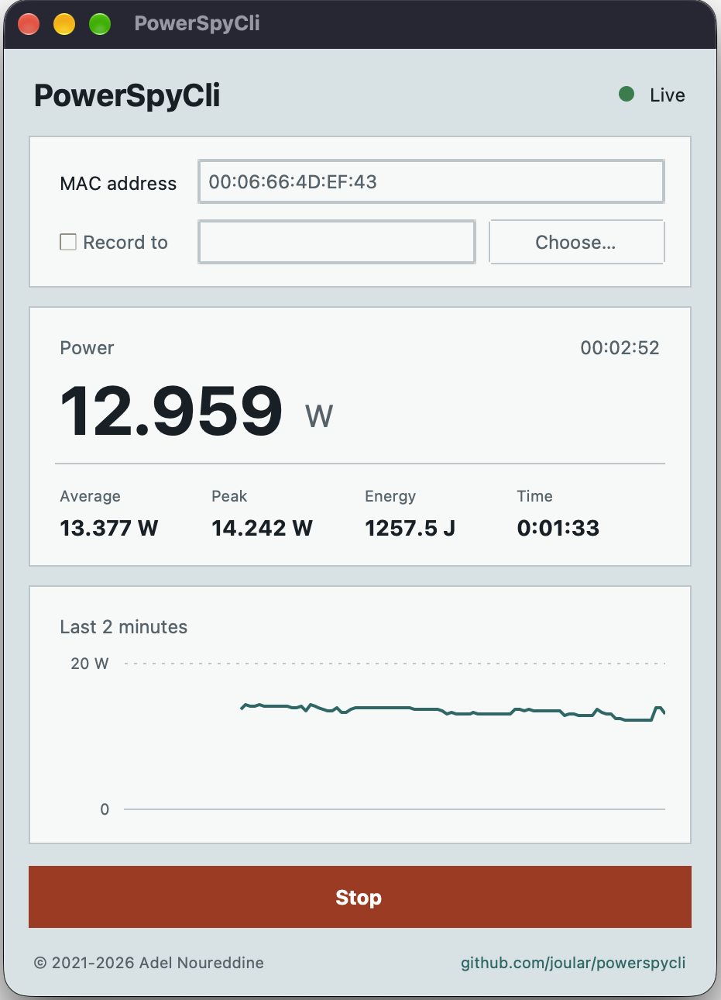

# <a href="https://www.noureddine.org/research/joular/"></a> PowerSpyCli

PowerSpyCli is a multi-platform software to connect and collect power metrics from a [PowerSpy 2 powermeter](https://www.alciom.com/nos-metiers/produits/powerspy2/).

PowerSpyCli supports Windows, Linux, and macOS (13 or later) with Python 3.7 or later (3.8 or later on macOS, for the PyObjC bridge). The command line and GUI use the same PowerSpy protocol and produce the same measurements on every platform.

## Installation

Just download the ```powerspycli.py``` file and run it with ```python3```.

On every system, pair the PowerSpy 2 in the operating system's Bluetooth settings before the first run.

### Linux setup

Bluetooth sockets need a CPython built with the BlueZ headers (```socket.AF_BLUETOOTH```). The distribution's ```python3``` has them; interpreters built by pyenv or uv may not, and PowerSpyCli then stops with "This Python installation does not provide Bluetooth RFCOMM sockets".

### macOS setup

PowerSpy 2 uses Bluetooth Classic Serial Port Profile (SPP). Python on macOS needs the PyObjC bridge to access Apple's native RFCOMM API:

```
python3 -m pip install pyobjc-framework-IOBluetooth
```

When using a repository checkout, `python3 -m pip install -r requirements-macos.txt` installs the same declared dependency.

Before running PowerSpyCli for the first time:

1. Turn on the PowerSpy 2 and pair it in **System Settings > Bluetooth**.
2. Run PowerSpyCli from Terminal and allow Bluetooth access when macOS asks.
3. If access was previously denied, open **System Settings > Privacy & Security > Bluetooth** and enable access for Terminal or the Python application used to launch PowerSpyCli.

Pairing is a one-time macOS setup step. PowerSpyCli continues to identify the device using its Bluetooth MAC address and does not perform pairing itself.

## Running PowerSpyCli

### Command line version

To run PowerSpyCli and start collecting power metrics, just run the software while providing the PowerSpy2 MAC address with the ```-m``` argument:

```
python3 powerspycli.py -m 00:11:22:33:44:55
```

### GUI version

To run PowerSpyCli GUI version, just run the software with the ```-g``` argument:

```
python3 powerspycli.py -g
```

The GUI version only uses Tkinter, which comes with Python. Some Linux distributions ship it as a separate package (e.g., `python3-tk`), and so does Homebrew Python on macOS (`python-tk`).



### Arguments

The ```-m``` argument is followed by the PowerSpy2 MAC address. It is required, except with ```-g```.

PowerSpyCli, by default, will display the power consumption of the PowerSpy2 every second: the timestamp (Unix epoch seconds in UTC, 3 decimals) and the power in watts (3 decimals).
To show all the collected metrics, run it with the ```-a``` argument. The columns are then the timestamp, the RMS voltage (V), the RMS current (A), the power (W), and the peak voltage (V) and peak current (A) seen during that second.

The ```-v``` argument will display all the logs and connection info (verbose mode).

To save the power data along with the timestamp to a CSV file, use the ```-f``` argument:
```python3 powerspycli.py -m 00:11:22:33:44:55 -f file.csv```.
If you don't specify a filename, a default file will be created named powerspy-$timestamp.csv (with $timestamp being the current timestamp date).
The file starts with a ```Timestamp;Power``` header line, then has one line per second with the Unix epoch time in UTC seconds (3 decimals) and the power in watts (3 decimals), separated by ```;```. If the file already exists, the new lines are appended to it.

When the Bluetooth link times out or is closed by the device, PowerSpyCli reconnects and reinitializes the PowerSpy, up to 5 times with a 2 seconds pause. The ```-r``` argument changes the number of attempts (```-r 0``` disables reconnection). Once they are exhausted, PowerSpyCli stops with an error message and exit code 1.

The ```-g``` argument will run the GUI interface instead of the command line one. The GUI prefills the MAC address and the recording file from ```-m``` and ```-f```, and also shows the voltage and current with ```-a```.

### macOS troubleshooting

- **PyObjC is missing:** run `python3 -m pip install pyobjc-framework-IOBluetooth` using the same Python interpreter that launches PowerSpyCli.
- **The device is not paired:** pair the PowerSpy 2 in **System Settings > Bluetooth**, then retry.
- **Bluetooth access is denied:** enable Terminal or Python in **System Settings > Privacy & Security > Bluetooth**.
- **Bluetooth is off or the RFCOMM channel cannot be opened:** turn Bluetooth on, make sure the PowerSpy is powered and nearby, disconnect other applications using it, and retry. PowerSpyCli discovers the device's SPP channel and falls back to the PowerSpy default channel 1.
- **A connection cannot be reopened after an interrupted run:** wait for PowerSpyCli's clean shutdown to finish, then retry. If another program owns the serial connection, close that program first.

Verbose mode (`-v`) includes SDP, RFCOMM channel, retry, and protocol diagnostics that are useful when reporting a connection problem.

## License

PowerSpyCli is forked from: [powerspy.py](https://github.com/patrickmarlier/powerspy.py/) with support for Python 3, replacing pyBluez with Python sockets, and many additional new features and updates.

It is licensed under the GNU Lesser General Public License v3.0 or later (LGPL-3.0-or-later).

Copyright (c) 2021-2026, Adel Noureddine.
All rights reserved. This program and the accompanying materials are made available under the terms of the  GNU Lesser General Public License v3.0 or later (LGPL-3.0-or-later) which accompanies this distribution, and is available at: https://www.gnu.org/licenses/lgpl-3.0.en.html
